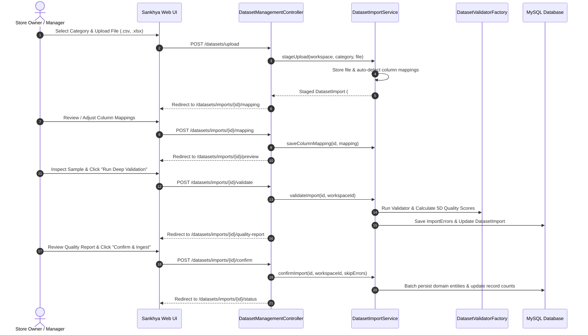

# SANKHYA — DATA IMPORT WORKFLOW MANUAL
## Comprehensive Operational & Technical Guide to Ingestion, Validation & Data Preparation

This document explains the end-to-end data import workflow implemented in Phase 2 of **Sankhya**.

---

## 1. Architectural Workflow Overview

The Sankhya ingestion pipeline is designed to eliminate common retail data ingestion issues: silent corruption, misaligned headers, negative prices, and referential drift. It enforces a 4-step progressive disclosure workflow:

---

## 2. Step-by-Step Workflow Execution

### Step 1: Uploading a File
- **Supported Formats:** `.csv`, `.xlsx`, `.xls` up to 50 MB.
- **Endpoint:** `GET /datasets/upload` and `POST /datasets/upload`.
- **Target Category Selection:** The user selects one of four supermarket categories:
  1. `SALES_TRANSACTIONS`
  2. `PRODUCT_CATALOG`
  3. `CUSTOMER_REGISTRY`
  4. `INVENTORY_STOCK`
- **Template Assistance:** Users can download a pre-formatted canonical template CSV via `/datasets/templates/{category}`.
- **Processing:** `FileStorageService` stores the uploaded file under `./data/uploads/workspaces/{workspaceId}/` with a unique UUID. `FileParserFactory` determines whether to invoke `CsvFileParser` or `ExcelFileParser`.

### Step 2: Automatic Schema Detection & Mapping Review
- **Endpoint:** `GET /datasets/imports/{id}/mapping` and `POST /datasets/imports/{id}/mapping`.
- **Auto-Detection Algorithm:** `DatasetSchemaDefinition.autoDetectMappings(...)` iterates over each uploaded column header. It strips punctuation, normalizes case, and compares against known aliases for each canonical field.
- **User Interface:** A clean mapping table displays canonical fields, data type badges, mandatory asterisks (`*`), dropdown selectors populated with all uploaded file headers, and sample values from the first 5 rows of the file.
- **Mandatory Validation:** The system ensures all required fields are mapped before proceeding.

### Step 3: Tabular Preview
- **Endpoint:** `GET /datasets/imports/{id}/preview`.
- **Display:** Displays the first 15 rows formatted under the mapped canonical column names with alternating row shading and monospace numbers.
- **Objective:** Allows visual verification that column data matches intended fields (e.g., prices are in the price column, dates in the date column) before running heavy validation.

### Step 4: Rule-Based Deep Validation & Quality Audit
- **Endpoint:** `POST /datasets/imports/{id}/validate` and `GET /datasets/imports/{id}/quality-report`.
- **Validation Pipeline:**
  1. **Data Type Parsing:** Dates and timestamps parsed across 10 common international and Indian retail patterns; numeric values parsed with automatic currency symbol stripping.
  2. **Range & Bound Verification:** Quantities must be $> 0$; unit costs, selling prices, and closing stocks must be $\ge 0$.
  3. **Formula Consistency Check:**
     - For Sales: `discount <= (quantity * unit_price)` and `revenue = (quantity * unit_price) - discount`.
     - For Inventory: `opening_stock + received_stock - sold_quantity = closing_stock`.
  4. **Referential Integrity Audit:** Verifies whether product SKUs in sales and stock snapshots exist in the active workspace's product catalog.
  5. **Composite Scoring:** Evaluates 5 dimensions (Completeness, Validity, Uniqueness, Consistency, Referential Integrity) to calculate the Overall Data Quality Score ($0-100\%$).
- **Reporting:** Displays the composite score, dimension progress bars, summary KPI tiles (Valid Rows, Invalid Rows, Duplicates), and an actionable error table.
- **Error CSV Download:** Users can download an error log via `GET /datasets/imports/{id}/errors/download`.

### Step 5: Database Ingestion & Confirmation
- **Endpoint:** `POST /datasets/imports/{id}/confirm` and `GET /datasets/imports/{id}/status`.
- **Batch Insertion:** Valid rows are parsed into domain entities (`Product`, `Customer`, `SalesTransaction`, or `InventorySnapshot`), linked to the active workspace, and saved in database batches.
- **Error Skipping:** The "Skip invalid rows" option ensures dirty records with critical errors do not block valid records from loading.
- **Catalog Counter Synchronization:** The parent `Dataset` entity's `record_count` and `last_imported_at` are updated.

---

## 3. Synthetic Indian Supermarket Data Generation

For instant demonstrations, testing, and multi-year analytical simulation without manual CSV creation, Sankhya provides a pure Java data generation engine:

- **Endpoint:** `GET /datasets/sample-generator` and `POST /datasets/sample-generator/generate`.
- **Options:**
  - **Timeline:** 12 Months (1 Year), 24 Months (2 Years - Recommended), or 36 Months (3 Years).
  - **Scale:**
    - `SMALL`: 15 Products, 40 Customers, ~500 Sales line items, ~600 Inventory snapshots.
    - `MEDIUM`: 25 Products, 80 Customers, ~3,500 Sales line items, ~2,600 Inventory snapshots.
    - `LARGE`: 30 Products, 200 Customers, ~8,000+ Sales line items, ~4,500 Inventory snapshots.
  - **Reset Option:** "Clear existing workspace data before synthesizing" allows resetting the store catalog.
- **Realism Features Included:**
  - Fast-moving consumer goods (FMCG) from Indian staples and brands: Amul, Tata Consumer, Aashirvaad (ITC), Maggi (Nestle), Fortune (Adani Wilmar), Britannia, Parle, Haldiram's, Everest, Dettol, Surf Excel.
  - Realistic Indian payment methods: 55% UPI, 25% Cash, 18% Cards, 2% Net Banking.
  - Multi-item baskets with realistic item quantities and occasional promotional discounts.
  - Weekly stock conservation balances: `opening + received - sold = closing`.
  - Temporal seasonality: Weekend shopping lifts (+40%), Diwali surges (+80-100% volume in Oct/Nov), Holi surges (March), and summer beverage demand spikes.
