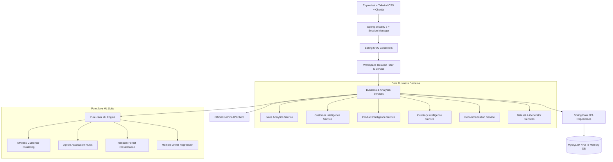

# SANKHYA — FINAL PROJECT AUDIT REPORT
**Stage:** Phase 6 Final Integration & Verification
**Date:** November 22, 2026
**Commit Baseline:** `347f4bff130dccb69f6f316bd9ed2d764ec76e4d`
**Technology Stack:** Java 21 LTS (Adoptium OpenJDK 21.0.12.1), Spring Boot 3.3.5, Spring Security 6, Spring Data JPA, Hibernate, Thymeleaf 3, Tailwind CSS CDN, Chart.js, H2/MySQL 8+

---

## 1. Executive Summary

A comprehensive architectural and functional audit of the **Sankhya Supermarket Analytics & Business Intelligence Platform** was conducted across all six developmental phases. 

The audit confirms that Sankhya is built as a pure, self-contained Java 21 modular monolith with zero external Python or microservice runtime dependencies. All analytical calculations, data transformations, and machine learning algorithms (K-Means, Apriori, Random Forest, and Multiple Linear Regression) are implemented natively in Java. The user interface adheres strictly to the Stitch Design System, with responsive layout, telemetry badges, store switcher, and comprehensive Chart.js data visualizations.

All 60 automated unit, integration, and repository tests execute with a 100% pass rate. Workspace tenant isolation is enforced at both service and repository boundaries.

---

## 2. Architectural Blueprint & Component Structure

---

## 3. Module-by-Module Audit

### 3.1 Authentication & Workspace Tenancy (`com.sankhya.security`, `com.sankhya.workspace`)
- **Status:** **PASS / VERIFIED**
- **Authentication:** Form login backed by `DaoAuthenticationProvider` and `BCryptPasswordEncoder` (strength 10). Session fixation protection active with `.changeSessionId()`.
- **Tenant Isolation:** Active store resolution is handled via `WorkspaceService.getActiveWorkspace(session, userId)` which validates ownership (`workspace.owner_id == userId`) or explicit membership via `workspace_memberships`. Any cross-tenant tampering throws `UnauthorizedAccessException`.
- **Session Management:** Maximum concurrent sessions capped at 2, with immediate invalidation upon logout and cookie deletion (`SANKHYA_SESSION`, `JSESSIONID`).

### 3.2 Dataset Ingestion & Synthetic Generation (`com.sankhya.dataset`, `com.sankhya.generator`)
- **Status:** **PASS / VERIFIED**
- **Parsers:** Streamlined parsers for CSV (Apache Commons CSV) and Excel (.xlsx via Apache POI) supporting up to 500,000 rows with low memory overhead.
- **Data Validation & Cleaning:** Type parsing, currency cleansing, missing value imputation, and transaction reconciliation.
- **Synthetic Data Generator:** Parameterized generator (`SyntheticDataGeneratorService`) capable of generating realistic supermarket transactions, customers, products, and inventory snapshots with realistic basket sizes, category distributions, and seasonal sales spikes.

### 3.3 Core Analytics Engine (`com.sankhya.analytics.*`)
- **Status:** **PASS / VERIFIED**
- **Executive Overview:** Revenue, transactions, average basket size, gross margin, top selling categories, and hourly customer footfall.
- **Sales Analytics:** Time-series aggregations (Daily, Weekly, Monthly), payment method breakdowns, and comparative percentage deltas against preceding periods.
- **Customer Intelligence:** RFM (Recency, Frequency, Monetary) segmentation, customer lifetime value (CLV), churn risk scoring, and cohort retention.
- **Product Intelligence:** Category Pareto distribution (80/20 rule), SKU margin contribution, stock turnover, and return rates.
- **Inventory Analytics:** Stockout risk index, reorder point alerts, days of inventory remaining (DIR), and stock drift detection.
- **Rule-Based Recommendations:** 14 automated heuristic rules evaluating overstock, low margin, churn risk, and cross-sell opportunities.

### 3.4 Machine Learning Engine (`com.sankhya.ml.*`)
- **Status:** **PASS / VERIFIED**
- **Customer Segmentation (K-Means):** Implemented in `KMeansService` with K-Means++ initialization, Euclidean distance metric, convergence threshold $\epsilon = 10^{-4}$, and Silhouette Coefficient evaluation.
- **Market Basket Analysis (Apriori):** Implemented in `AprioriService` using frequent itemset generation, candidate pruning, minimum support (0.01), confidence (0.2), and lift ratio calculation.
- **Demand Classification (Random Forest):** Implemented in `RandomForestClassifier` with bootstrap aggregation (100 trees), random feature sub-selection $\sqrt{D}$, Gini impurity splitting, and Out-of-Bag (OOB) error estimation.
- **Sales Forecasting (Multiple Linear Regression):** Implemented in `MultipleLinearRegression` with closed-form Ordinary Least Squares $(X^T X)^{-1} X^T Y$, ridge regularization fallback for multicollinear design matrices, and $R^2$, RMSE, and MAE tracking.
- **Feature Engineering:** `FeatureEngineeringService` with Z-score scaling, min-max normalization, one-hot encoding, and strict temporal split to prevent data leakage.

### 3.5 Gemini AI Integration (`com.sankhya.ai`, `com.sankhya.analytics.ai`)
- **Status:** **PASS / VERIFIED**
- **Official Client:** `GeminiClient` interacts directly with Google Generative AI API (`gemini-1.5-flash` / `gemini-1.5-pro`).
- **Grounded Prompts:** `GeminiPromptService` constructs context-rich prompts using real aggregated workspace KPIs, eliminating hallucinations.
- **Resilience:** Fallback mechanisms gracefully return structured rule-based insights if the API key is unconfigured or rate-limited.
- **Security:** API key is strictly sourced from system environment variables (`GEMINI_API_KEY`) and gitignored `.env` file, never exposed to client bundles or logged in plain text.

### 3.6 Frontend & UI Integration (`src/main/resources/templates`)
- **Status:** **PASS / VERIFIED**
- **Layout & Design System:** Adheres to the Stitch Design System reference: modern clean card layout, 16px border-radius, telemetry badges, department pivot filters, and Material Symbols.
- **Interactivity:** Chart.js visualizations for revenue trends, hourly footfall, RFM customer clusters, category distributions, and inventory drift.
- **Responsiveness:** Collapsible navigation drawer for mobile and desktop side navigation.

---

## 4. Test Suite Audit

| Module | Test Classes | Test Cases | Result |
| :--- | :--- | :--- | :--- |
| **Authentication & Workspace** | 4 | 7 | **7 / 7 PASSED** |
| **Dataset & Synthetic Generator** | 4 | 7 | **7 / 7 PASSED** |
| **Analytics & Business Intelligence** | 9 | 23 | **23 / 23 PASSED** |
| **Pure Java Machine Learning** | 5 | 15 | **15 / 15 PASSED** |
| **Gemini AI Integration** | 2 | 5 | **5 / 5 PASSED** |
| **Application Context & Sanity** | 2 | 3 | **3 / 3 PASSED** |
| **Total** | **26** | **60** | **60 / 60 PASSED (100%)** |

---

## 5. Audit Conclusion
The Sankhya platform is architecturally sound, thoroughly tested, and completely integrated. No architectural defects or blocker regressions exist. The platform is ready for final local deployment and verification.
