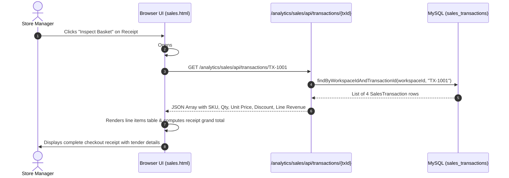

# SANKHYA — FRONTEND API & BACKEND INTEGRATION SPECIFICATION

**Platform:** Sankhya — Supermarket Analytics & Business Intelligence  
**Phase:** 4 — Frontend Integration, Dashboard Development & Application-Wide Wiring  
**Date:** November 22, 2026  

---

## 1. Controller Routing & API Contracts

Sankhya utilizes a Spring Boot 3.3.5 / Spring MVC architecture where controllers provide server-rendered Thymeleaf views alongside RESTful JSON endpoints for asynchronous drill-downs and client-side interactions.

### 1.1 Complete Route Catalog

| Module | HTTP Method | Path | Controller | Parameters | Output Type |
|---|---|---|---|---|---|
| **Overview** | `GET` | `/dashboard` | `DashboardController` | `preset`, `startDate`, `endDate` | HTML View (`dashboard/overview`) |
| **Sales** | `GET` | `/analytics/sales` | `SalesAnalyticsController` | `preset`, `startDate`, `endDate` | HTML View (`analytics/sales`) |
| **Sales API** | `GET` | `/analytics/sales/api` | `SalesAnalyticsController` | `preset`, `startDate`, `endDate` | JSON (`SalesAnalyticsResponse`) |
| **Basket Drill-Down** | `GET` | `/analytics/sales/api/transactions/{txId}` | `SalesAnalyticsController` | Path: `transactionId` | JSON (`List<SalesTransaction>`) |
| **Customers** | `GET` | `/analytics/customers` | `CustomerIntelligenceController` | `preset`, `startDate`, `endDate` | HTML View (`analytics/customers`) |
| **Customers API** | `GET` | `/analytics/customers/api` | `CustomerIntelligenceController` | `preset`, `startDate`, `endDate` | JSON (`CustomerIntelligenceResponse`) |
| **Recommendations** | `GET` | `/analytics/recommendations` | `RecommendationsController` | `category`, `status` | HTML View (`analytics/recommendations`) |
| **Recommendations API**| `GET` | `/analytics/recommendations/api` | `RecommendationsController` | `category`, `status` | JSON (`List<BusinessRecommendation>`) |
| **Trigger Rec Scan** | `POST`| `/analytics/recommendations/generate` | `RecommendationsController` | `preset`, `startDate`, `endDate` | Redirect (`/analytics/recommendations`) |
| **Update Rec Status** | `POST`| `/analytics/recommendations/{id}/status` | `RecommendationsController` | Path: `id`, Form: `status` | Redirect (`/analytics/recommendations`) |
| **Inventory** | `GET` | `/analytics/inventory` | `InventoryAnalyticsController` | `preset`, `startDate`, `endDate` | HTML View (`analytics/inventory`) |
| **Inventory API** | `GET` | `/analytics/inventory/api` | `InventoryAnalyticsController` | `preset`, `startDate`, `endDate` | JSON (`InventoryIntelligenceResponse`) |
| **Products** | `GET` | `/analytics/products` | `ProductIntelligenceController` | `preset`, `startDate`, `endDate` | HTML View (`analytics/products`) |
| **Products API** | `GET` | `/analytics/products/api` | `ProductIntelligenceController` | `preset`, `startDate`, `endDate` | JSON (`ProductIntelligenceResponse`) |
| **AI Insights** | `GET` | `/analytics/ai-insights` | `AiInsightsController` | None (reads active workspace) | HTML View (`analytics/ai-insights`) |
| **Dataset Manager** | `GET` | `/datasets` | `DatasetManagementController` | None | HTML View (`dataset/list`) |
| **Reports Center** | `GET` | `/analytics/reports` | `AnalyticalReportingController` | `preset`, `startDate`, `endDate` | HTML View (`analytics/reports`) |
| **Report Export CSV**| `GET` | `/analytics/reports/{type}` | `AnalyticalReportingController` | Path: `sales`, `customers`, etc. | CSV Attachment (`text/csv`) |
| **Workspace Select** | `POST`| `/workspaces/{id}/select` | `WorkspaceController` | Path: `id` | Redirect to referring view |
| **Settings** | `GET` | `/settings` | `SettingsController` | None | HTML View (`settings/index`) |

---

## 2. Asynchronous & Client-Side Interactivity

### 2.1 Basket Line-Item Drill-Down Flow

### 2.2 What-If Business Simulation Engine

The What-If Business Simulator (`/analytics/ai-insights`) operates on a client-side execution model seeded with the active workspace's actual monthly telemetry:

$$\text{Volume Factor} = 1 + \left( \frac{\text{Uplift \%}}{100} \times \frac{\text{Elasticity}}{1.2} \right)$$

$$\text{Effective Price Factor} = 1 - \left( \frac{\text{Discount \%}}{100} \right)$$

$$\text{Simulated Revenue} = \text{Baseline Revenue} \times \text{Volume Factor} \times \text{Effective Price Factor}$$

$$\text{Diluted Margin Rate} = \max\left(0.08, \text{Baseline Margin} - \left( \frac{\text{Discount \%}}{100} \times 0.45 \right)\right)$$

$$\text{Simulated Gross Profit} = \text{Simulated Revenue} \times \text{Diluted Margin Rate}$$

$$\text{Simulated Working Capital} = \text{Baseline Capital} \times \left(1 + \left( \frac{\text{Uplift \%}}{100} \times 0.72 \right)\right)$$

Live DOM and SVG path morphing are triggered immediately on `input` events of the promotional discount and footfall sliders without requiring page reloads.

### 2.3 Recommendation Lifecycle Transition Flow

Managers can manage rule-based action items through three state transition forms:
1. `NEW` $\rightarrow$ `REVIEWED`: Triggered via "Mark Reviewed", signifying a store manager has acknowledged the directive.
2. `REVIEWED` $\rightarrow$ `RESOLVED`: Triggered via "Mark Resolved", indicating the purchase order has been placed or the pricing adjustment has been applied.
3. `ANY` $\rightarrow$ `DISMISSED`: Dismisses the recommendation for the active analytical window.

Every transition sends a standard Spring MVC `POST` to `/analytics/recommendations/{id}/status`, verifies active workspace tenancy, persists the update via `businessRecommendationRepository.save()`, and delivers a redirect with `FlashAttributes` rendered via `fragments/alerts.html`.

---

## 3. Multi-Tenant Scoping & Security

1. **Authentication:** Every controller method enforces `@AuthenticationPrincipal CustomUserDetails userDetails`.
2. **Active Workspace Resolution:** The controller resolves the tenant context via `workspaceService.getActiveWorkspace(session, userDetails.getId())`.
3. **Data Isolation:** All analytical database queries, repository calls, transaction lookups, and recommendation status mutations take `activeWorkspace.getId()` as the partition key:
   - `salesTransactionRepository.findByWorkspaceIdAndTransactionId(wsId, txId)`
   - `businessRecommendationRepository.findByIdAndWorkspaceId(id, wsId)`
   - `inventorySnapshotRepository.findByWorkspaceId(wsId)`
4. **Tenant Mismatch Prevention:** Cross-workspace inspection or modification is rejected at the service layer, returning HTTP 400 or throwing an unauthorized access exception.

---

## 4. Resilience, Empty States & Data Partition Readiness

Every analytical controller queries `DatasetQueryService.getAnalyticsReadiness(workspaceId)` before invoking the analytical engines:
- If a dataset partition (e.g. Sales, Customers, Inventory, or Products) is missing, the view suppresses raw calculation tables and gracefully displays a dedicated warning alert with quick-action buttons:
  - **Generate Synthetic Data:** Routes directly to `/datasets/generate` to auto-populate the active store workspace.
  - **Upload Data:** Routes to the 6-step CSV/Excel ingestion pipeline at `/datasets/upload`.
