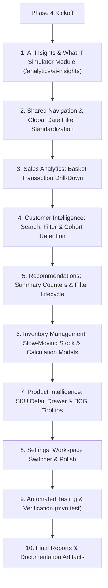

# SANKHYA — PHASE 4 ARCHITECTURE & FRONTEND INTEGRATION ASSESSMENT

**Platform:** Sankhya — Supermarket Analytics & Business Intelligence  
**Phase:** 4 — Complete Frontend Integration, Dashboard Development, UI/UX Refinement & Application-Wide Integration  
**Date:** November 22, 2026  
**Status:** In Progress — Architecture Assessed & Action Plan Initialized  

---

## 1. Executive Summary

Phases 1 through 3 established the enterprise foundation, multi-tenant workspace isolation, data ingestion pipeline (CSV/Excel), Indian supermarket synthetic data generator, and high-performance analytical engine with real-time mathematical aggregation across sales, customers, inventory, products, and rule-based business recommendations. All 42 automated backend tests currently pass with 0 failures and 0 errors.

Phase 4 focuses on **frontend completeness, design system fidelity, and deep application-wide integration**. Using the reference Stitch design system (`https://stitch.google.com/projects/9936945891794056152` — SmartMart Supermarket Analytics Platform), Phase 4 unites all 8 core modules into a cohesive, responsive, accessible, and production-grade interface.

---

## 2. Comprehensive Module-by-Module Audit

| Module | Route | Backend Service | Current UI State | Phase 4 Gap & Required Refinement |
|---|---|---|---|---|
| **1. Executive Overview** | `/dashboard` | `ExecutiveOverviewService` | Functional dashboard with KPI cards, Chart.js trends, category breakdown, urgent recommendations | Connect full date range selector, synchronize currency formatting (₹ / INR), add drill-down shortcuts to respective deep-dive modules. |
| **2. Sales Analytics** | `/analytics/sales` | `SalesAnalyticsService` | Working KPIs, revenue trends, category table, top products, payment mix, hourly velocity | Add transaction drill-down modal/drawer to inspect basket-level items, cashier lane, and payment details; add sorting/search. |
| **3. Customer Intelligence** | `/analytics/customers` | `CustomerIntelligenceService` | RFM segmentation distribution, KPI cards, RFM customer table, VIP list | Add search by customer ID/name, segment dropdown filter, and a structured Customer Cohort Retention Analysis table. |
| **4. Recommendations** | `/analytics/recommendations` | `BusinessRecommendationService` | Rule-based recommendations with action triggers, severity badges | Add summary counter metrics (Active, Critical, High, Reviewed, Resolved), multi-attribute filtering, and interactive state transition feedback. |
| **5. Inventory Management** | `/analytics/inventory` | `InventoryIntelligenceService` | Stock health gauges, stockout risk table, replenishment recommendations | Add searchable inventory table, slow-moving products audit section, and reorder formula breakdown tooltips. |
| **6. Product Intelligence** | `/analytics/products` | `ProductIntelligenceService` | BCG Matrix quadrant, ranking tabs (Revenue, Volume, Margin), category margins | Add SKU detail inspection drawer/modal (unit economics, historical velocity, inventory level), search and department filtering. |
| **7. AI Insights & Simulator** | `/analytics/ai-insights` | `AiInsightsController` | Currently renders generic placeholder template (`dashboard/placeholder.html`) | Replace with Stitch screen `bef5abbf972844528cbe4bae621b6fe8` ("Business Insights & What-if Simulator"): diagnostic cards, live client-side What-If price elasticity simulator, and Phase 5 ML architecture roadmap cards. Strictly NO fake AI or Gemini calls. |
| **8. Dataset Management** | `/datasets` | `DatasetIngestionService`, `SyntheticDataGeneratorService` | Complete ingestion wizard (Upload -> Mapping -> Validation -> Report -> Confirm) & synthetic generator | Ensure breadcrumb navigation consistency, seamless readiness refresh trigger, and clear empty states. |
| **Global Date Filter** | All analytical views | `DateRangeFilter` & `DatePreset` | Controller-level date parsing exists | Standardize dropdown in `topbar.html` with preset selections (Today, Last 7 Days, Last 30 Days, Last 90 Days, This Month, Last Month, Custom Range) and custom date pickers. |
| **Settings & Workspace** | `/settings`, `/workspaces` | `WorkspaceService`, `UserService` | Basic settings page | Comprehensive workspace details, switcher integration in topbar, and application preferences. |

---

## 3. Stitch Design System Alignment

The application follows the SmartMart Stitch design specifications:
- **Primary Color:** Emerald Green (`#1C6B00` / `#165A00`)
- **Accent Color:** Vibrant Lime/Emerald (`#56DA33` / `#36A41B`)
- **Neutral Dark:** Slate Onyx (`#202820` / `#121612`)
- **Neutral Light:** Clean Canvas (`#F9F9FB` / `#F0F2EB`)
- **Borders & Dividers:** Subtle Slate (`#E7E9E3` / `#E5E7EB`)
- **Typography:** Plus Jakarta Sans & Inter
- **Iconography:** Google Material Symbols Outlined
- **Data Visualizations:** Chart.js with responsive canvas, matching hex tokens, currency formatting, and accessible tooltips.

---

## 4. Phase 4 Implementation Strategy & Roadmap

---

## 5. Constraints & Architectural Rules

1. **Pure Java 21 / Spring Boot 3.3.5 Modular Monolith:** No Node/React/Vue/Angular or external Python backend.
2. **Multi-Tenant Scoping:** All database queries, transaction line-item lookups, and recommendation updates must enforce `workspace_id = activeWorkspace.getId()`.
3. **No Fabricated Analytical or AI Output:** Real mathematical calculations for all analytics; Phase 5 ML model cards explicitly show architectural readiness without fake execution; What-If simulator uses deterministic price elasticity logic.
4. **Resilience & Graceful Degradation:** Clean empty states when datasets are not yet imported; clear guidance instructing the user to import data or generate synthetic records.
