# SANKHYA — PHASE 4 IMPLEMENTATION REPORT
## Complete Frontend Integration, Dashboard Development, UI/UX Refinement & Application-Wide Integration

**Project Name:** Sankhya  
**Platform Domain:** AI-Powered Supermarket Analytics & Business Intelligence  
**Phase Completed:** Phase 4 of 6  
**Implementation Date:** November 22, 2026  
**Status:** **100% COMPLETE & VERIFIED (49/49 Tests Passing, 0 Failures, 0 Errors)**  
**Stitch Project Reference:** `https://stitch.google.com/projects/9936945891794056152` ("SmartMart Supermarket Analytics Platform")  

---

## 1. Executive Summary

Phase 4 has successfully unified all previously constructed analytical layers (Phase 1 enterprise auth and workspaces, Phase 2 dataset ingestion and Indian synthetic data generation, and Phase 3 core analytics engine) into a cohesive, responsive, accessible, and high-performance supermarket business intelligence platform.

### Key Achievements in Phase 4:
1. **Design System & Visual Fidelity:** Recreated the complete visual identity from the Stitch reference screens using Tailwind CSS, Google Material Symbols, and Plus Jakarta Sans / Inter typography.
2. **Module 7 AI Insights & Simulator:** Replaced the legacy placeholder with the complete Stitch screen `bef5abbf972844528cbe4bae621b6fe8` ("Business Insights & What-if Simulator"). Features automated diagnostic insight cards, an interactive client-side What-If business simulator with dynamic elasticity curves and real-time revenue/profit projections, and 5 Phase 5 ML architecture cards without fabricated execution.
3. **Transaction Basket Drill-Down:** Implemented receipt inspection in Sales Analytics (`/analytics/sales`), connecting `/analytics/sales/api/transactions/{id}` to an interactive receipt modal displaying individual basket line items, cashier lane, and payment details.
4. **Customer Cohort Retention & Search:** Enhanced Customer Intelligence (`/analytics/customers`) with a Month 0–4 customer retention decay matrix and instant client-side search/segment filtering across the 9 RFM quintile scores.
5. **Recommendation Lifecycle & Counters:** Upgraded Recommendations (`/analytics/recommendations`) with 5 top summary counter cards (`Active`, `Critical`, `High`, `In Review`, `Resolved`), multi-attribute filtering, and interactive state transition actions (`NEW` $\rightarrow$ `REVIEWED` $\rightarrow$ `RESOLVED` / `DISMISSED`).
6. **Inventory Replenishment & Slow-Moving Stock:** Added search and urgency badges to the reorder table in Inventory Intelligence (`/analytics/inventory`) and introduced a dedicated slow-moving stock audit section.
7. **SKU Economics Inspection:** Implemented interactive product economics inspection modals in Product Intelligence (`/analytics/products`) with BCG quadrant retail strategies.
8. **Shared Shell Polish:** Upgraded `topbar.html` with a working workspace switcher dropdown, active date range selector dropdown with preset support, real-time alert notifications popup, and responsive mobile sliding drawer with backdrop overlay.
9. **Automated Testing:** Added `AiInsightsControllerTest`, `SalesAnalyticsControllerTest`, and `RecommendationsControllerTest`, achieving **49 passing tests with 0 failures and 0 errors**.

---

## 2. Architecture & Design System Implementation

```mermaid
flowchart TD
    subgraph UI_Shell["Standardized Application Shell (layout/base.html)"]
        Top["Dual-Tier Topbar (fragments/topbar.html)<br/>Workspace Switcher • Global Date Preset • Notifications"]
        Side["Sub-Tools Sidebar (fragments/sidebar.html)<br/>8 Core Modules • Department Pivots • Mobile Drawer"]
        Alert["Alerts Fragment (fragments/alerts.html)<br/>Flash Messages • Status Confirmation Toasts"]
    end

    subgraph Analytical_Views["8 Integrated Core Modules"]
        M1["Module 1: Executive Overview (/dashboard)"]
        M2["Module 2: Sales Analytics (/analytics/sales)"]
        M3["Module 3: Customer Intelligence (/analytics/customers)"]
        M4["Module 4: Recommendations (/analytics/recommendations)"]
        M5["Module 5: Inventory Intelligence (/analytics/inventory)"]
        M6["Module 6: Product Intelligence (/analytics/products)"]
        M7["Module 7: AI Insights & Simulator (/analytics/ai-insights)"]
        M8["Module 8: Dataset Pipeline (/datasets)"]
    end

    subgraph Backend_Services["Spring Boot Core Engine"]
        EOS["ExecutiveOverviewService"]
        SAS["SalesAnalyticsService"]
        CIS["CustomerIntelligenceService"]
        BRS["BusinessRecommendationService"]
        IIS["InventoryIntelligenceService"]
        PIS["ProductIntelligenceService"]
        DQS["DatasetQueryService"]
    end

    subgraph Storage["Multi-Tenant Persistence"]
        DB[(MySQL Database partitioned by workspace_id)]
    end

    UI_Shell --> Analytical_Views
    Analytical_Views --> Backend_Services
    Backend_Services --> Storage
```



### 2.1 Color Palette & Tokens
- **Primary Green:** `#1C6B00` / `#186E00` (Core brand, primary actions, positive trend badges)
- **Primary Container:** `#56DA33` (Live telemetry pings, secondary buttons)
- **Surface Lowest:** `#FFFFFF` (Card surfaces, modals, data tables)
- **Surface Low:** `#F9F9FB` / `#F0F2EB` (Inputs, subtle alternating backgrounds)
- **Surface High:** `#E6F1E1` / `#EFF9E9` (Active selections, high-contrast rows)
- **Border / Divider:** `#E7E9E3` (Subtle container outlines)
- **Text On-Surface:** `#141E14` (High-contrast typography)
- **Severity Colors:** Critical `#BA1A1A`, High `#F59E0B`, Normal `#3B82F6`, Resolved `#10B981`

---

## 3. Module-by-Module Integration Details

### 3.1 Module 1: Executive Overview Dashboard (`/dashboard`)
- **Controller:** `DashboardController` $\rightarrow$ `ExecutiveOverviewService`
- **KPI Cards:** Gross Revenue, Transactions, ATV, Active Customers, Gross Margin %, Stock Alerts.
- **Visuals:** Chart.js daily revenue velocity line chart and category sales contribution donut chart.
- **Descriptive Insights:** Algorithmic business takeaways derived live from the current window.
- **Urgent Action Items:** Top critical and high priority recommendations with immediate review links.

### 3.2 Module 2: Sales Analytics & Basket Dynamics (`/analytics/sales`)
- **Controller:** `SalesAnalyticsController` $\rightarrow$ `SalesAnalyticsService`
- **KPI Cards:** Gross Revenue, Total Invoices, ATV, Units Sold, Items Per Basket, Discounts Given.
- **Visuals:** Revenue time series curve, 24-hour trading velocity curve, and payment tender mix donut.
- **Tables:** Departmental revenue & margins table, Top 10 selling products table with search.
- **Basket Line-Item Drill-Down:**
  - Interactive stream of recent invoices.
  - Clicking "Inspect Basket" triggers an AJAX fetch to `/analytics/sales/api/transactions/{id}`.
  - Receipt modal dialog displays cashier lane, store ID, customer ID, SKU list, unit price, quantity, discount, line total, and grand total.

### 3.3 Module 3: Customer Intelligence & RFM Segmentation (`/analytics/customers`)
- **Controller:** `CustomerIntelligenceController` $\rightarrow$ `CustomerIntelligenceService`
- **KPI Cards:** Total Catalog Customers, Active Customers, New Registrations, Returning Shoppers, Repeat Purchase Rate %, ARPU.
- **RFM Segments Summary:** 9 canonical retail lifecycle segments (Champions, Loyal Customers, Potential Loyalists, Recent Customers, Promising, Need Attention, About to Sleep, At Risk, Cannot Lose Them).
- **Cohort Retention Table:** Month 0 to Month 4 customer retention decay matrix.
- **RFM Quintile Matrix Table:** Full customer table with individual Recency (days), Frequency, Monetary (₹), R, F, M quintile scores, composite RFM code, and assigned segment. Features interactive client-side search by Customer ID / Name and segment dropdown filtering.

### 3.4 Module 4: Business Recommendations Engine (`/analytics/recommendations`)
- **Controller:** `RecommendationsController` $\rightarrow$ `BusinessRecommendationService`
- **Summary Metrics:** 5 counter cards: Total Active, Critical Alerts, High Priority, In Review, Resolved.
- **Filtering:** Category filter tabs, Status filter tabs, and client-side title/description search.
- **Lifecycle Transitions:** Status forms with immediate flash alert feedback:
  - `Mark Reviewed`: Moves new recommendation to `REVIEWED`.
  - `Mark Resolved`: Moves recommendation to `RESOLVED`.
  - `Dismiss`: Dismisses recommendation for current window.
- **Trigger Scan:** "Run Recommendation Scan" button evaluating active store telemetry.

### 3.5 Module 5: Inventory Intelligence & Reorder Engine (`/analytics/inventory`)
- **Controller:** `InventoryAnalyticsController` $\rightarrow$ `InventoryIntelligenceService`
- **KPI Cards:** Tracked SKUs, Cost Valuation, Retail Valuation, Low Stock SKUs, Out of Stock SKUs, Turnover Ratio.
- **Stock Health Donut:** Healthy, Low Stock, Out of Stock, Overstocked.
- **Stock Movement Trend:** Daily opening, received, sold, and closing stock line chart.
- **Actionable Replenishment Table:** Reorder suggestions with calculated order quantity, restock cost in ₹, and urgency level.
- **Slow-Moving Stock Audit:** Identifies high capital allocation SKUs with low sales velocity and suggests promotions or checkout placement.

### 3.6 Module 6: Product Intelligence & Margin Quadrants (`/analytics/products`)
- **Controller:** `ProductIntelligenceController` $\rightarrow$ `ProductIntelligenceService`
- **KPI Cards:** Catalog SKUs, Active Selling SKUs, Units Sold, Overall Gross Margin %, Lead Category.
- **BCG Quadrant Tiles:** Stars, Cash Cows, Opportunities, Underperformers.
- **Departmental Unit Economics:** Table with catalog items, units sold, gross turnover, COGS, profit, and margin %.
- **SKU Economics Inspection Modal:** Clicking "Economics" opens an inspection modal displaying units sold, gross revenue, COGS, gross profit, margin %, and BCG retail advice.

### 3.7 Module 7: AI Insights & What-If Simulator (`/analytics/ai-insights`)
- **Controller:** `AiInsightsController`
- **Stitch Screen Alignment:** Full implementation of Stitch screen `bef5abbf972844528cbe4bae621b6fe8`.
- **Diagnostic AI Insights:** Automated cards for Margin Expansion Opportunity and Unusual Sales Surge / Stockout Risk.
- **What-If Business Simulator:**
  - Department selector, Promotional Discount Slider (0-30%), Footfall Uplift Slider (0-50%), Price Elasticity Buttons (0.8, 1.2, 1.6).
  - Real-time client-side calculation of Projected Monthly Revenue, Gross Profit, Blended Margin %, and Working Capital Required.
  - Interactive SVG trajectory curve adjusting shape live on slider input.
  - Save Scenario CTA with visual confirmation toast ("Scenario Saved to Executive Vault!").
- **Phase 5 ML Architecture Cards:** 5 enterprise model cards detailing algorithms, inputs, and business purposes (K-Means, Apriori, Random Forest, Linear Regression, Gemini LLM).
- **Direct Bridges:** Direct links to Customer RFM, Product BCG, and Business Recommendations.

### 3.8 Module 8: Dataset Management Pipeline (`/datasets`)
- Complete 6-step ingestion pipeline: Upload -> Mapping -> Preview -> Validation -> Quality Report -> Import.
- Indian Supermarket Synthetic Data Generator producing 5 realistic CSV partitions.
- Dynamic Analytics Readiness check triggering automatic dashboard synchronization upon data ingestion.

---

## 4. Multi-Tenant Scoping & Security

All controllers enforce multi-tenant isolation:
1. Active workspace resolved from session and authenticated user details:
   ```java
   Workspace activeWorkspace = workspaceService.getActiveWorkspace(session, userDetails.getId());
   ```
2. Every analytical query, repository lookup, transaction fetch, and status mutation strictly enforces `workspace_id = activeWorkspace.getId()`.
3. Cross-tenant access is rejected at the repository/service layer.

---

## 5. Automated Testing & Verification

A comprehensive automated test suite covers unit, integration, and controller layers:
- **Total Tests:** 49
- **Failures:** 0
- **Errors:** 0
- **Skipped:** 0
- **Build Status:** `BUILD SUCCESS` (Compiled with Java 21)

---

## 6. Readiness for Phase 5

Phase 4 leaves Sankhya completely integrated and ready for **Phase 5: Machine Learning, Predictive Modeling, Gemini AI Insights & Natural Language Explanations**:
- Backend data pipelines, normalized tables, and analytical summary DTOs are in place.
- Module 7 UI is structured to display future Weka ML model evaluations and Gemini LLM executive briefs.
- The platform strictly adheres to the principle of deterministic calculation before natural language explanation.
