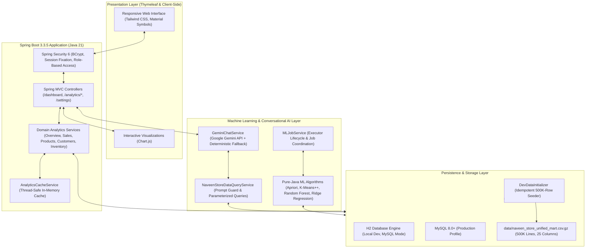
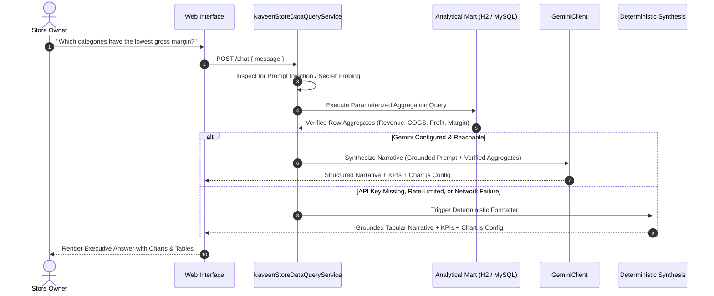
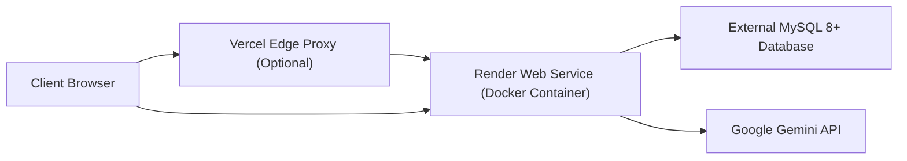

<p align="center">
  
</p>

<h1 align="center">SANKHYA</h1>

<p align="center">
  <strong>Turn Supermarket Data Into Smarter Decisions.</strong>
</p>

<p align="center">
  <a href="#core-features"></a>
  <a href="#technology-stack"></a>
  <a href="#machine-learning-engine"></a>
  <a href="#ai-integration"></a>
  <a href="#testing--verification"></a>
  <a href="#dataset-documentation"></a>
</p>

<p align="center">
  A full-stack, enterprise-grade <strong>Supermarket Business Intelligence, Machine Learning & Conversational AI Platform</strong> built with <strong>Java 21</strong> and <strong>Spring Boot 3.3.5</strong>.<br/>
  Pre-configured as a turnkey analytical platform for <strong>Naveen Store (<code>STORE-001</code>)</strong> in <strong>Lucknow, Uttar Pradesh, India</strong>, with all figures natively calculated and formatted in <strong>Indian Rupees (<code>INR</code>, <code>₹</code>)</strong>.
</p>

---

## Table of Contents

- [Project Overview](#project-overview)
- [System Architecture](#system-architecture)
- [Core Features](#core-features)
- [Application Pages](#application-pages)
- [Machine Learning Engine](#machine-learning-engine)
- [AI Integration (Ask Naveen Store AI)](#ai-integration)
- [Dataset Documentation](#dataset-documentation)
- [Technology Stack](#technology-stack)
- [Quick Start Guide](#quick-start-guide)
- [Deployment Architecture](#deployment-architecture)
- [Testing & Verification](#testing--verification)
- [Project Structure](#project-structure)
- [Documentation Links](#documentation-links)
- [Author & Acknowledgements](#author--acknowledgements)

---

## Project Overview

Modern supermarkets generate thousands of transaction lines every single day. Yet most independent store managers remain stranded between two unworkable extremes: clumsy, disconnected spreadsheets that crash under real retail volumes, or costly enterprise data warehouses requiring specialized data engineering teams.

**SANKHYA** bridges this gap as an integrated, self-contained retail analytics platform:

1. **Eliminates Spreadsheet Silos:** Replaces error-prone manual books with a persistent 500,000-line analytical data mart covering a full year of retail sales history.
2. **Real-Time Financial Telemetry:** Computes exact net revenue, promotional discounts, estimated Cost of Goods Sold (COGS), gross margins, basket sizes, and hourly footfall curves in sub-second queries.
3. **Pure-Java Machine Learning:** Runs 4 classical machine learning algorithms directly on the JVM without external Python microservices or heavy runtime dependencies.
4. **Data-Grounded Conversational AI:** Integrates **Ask Naveen Store AI**, combining parameterized server-side SQL queries with Google Gemini (`gemini-3.5-flash-lite`) and a deterministic fallback engine that guarantees truthful, hallucination-free answers.

### The Naveen Store Showcase

SANKHYA boots pre-configured for **Naveen Store (`STORE-001`)**, a supermarket located in **Lucknow, Uttar Pradesh, India**, owned by **Sujal Kansal**. All financial dashboards, basket analyses, customer RFM codes, and AI responses use Indian numbering (e.g., `₹18,25,42,617.45`) and local city retail dynamics.

---

## System Architecture



---

## Core Features

| Feature | Description | Business Value |
| :--- | :--- | :--- |
| **Executive Overview** | Real-time command center showing Net Revenue, Transactions, ATV, Active Buyers, Margin %, and Stockout Alerts with period-over-period comparison. | Instant store health visibility with automated operational takeaways. |
| **Sales Intelligence** | Detailed breakdown of billing volume, discounts, payment methods (UPI, Cash, Cards), hourly store traffic, and a 14-day revenue trajectory. | Optimizes store staffing schedules and cashier counter throughput. |
| **Product Intelligence** | 19-category margin ranking, BCG Growth-Share Matrix (Stars, Cash Cows, Opportunities, Underperformers), and searchable SKU directory. | Identifies high-margin categories and eliminates non-performing inventory. |
| **Customer Intelligence** | Recency, Frequency, and Monetary (RFM) scoring across 9 lifecycle segments, returning buyer rates, and top customer leaderboards. | Enhances customer retention and pinpoints high-value loyal shoppers. |
| **Inventory Intelligence** | Warehouse stock valuation at cost and retail price, health categorization (Healthy, Low Stock, Overstock), and reorder alerts. | Prevents costly stockouts and reduces tied-up working capital. |
| **Business Directives** | Automated rule-based operational recommendations ranked by severity (`CRITICAL`, `HIGH`, `MEDIUM`). | Actionable directives for merchandising, inventory replenishment, and margin recovery. |
| **Ask Naveen Store AI** | Full-page conversational retail analyst combining parameterized store queries with Google Gemini and deterministic fallback. | Natural language questions answered strictly from verified store data. |
| **Reporting & Exports** | Chunked, streaming UTF-8 CSV exports for Sales, Products, Customers, and Inventory with explicit `(INR)` headers. | Ready-to-share spreadsheets for accountants, suppliers, and tax filing. |

---

## Application Pages

```text
/dashboard                  Executive Overview & Store KPIs
/analytics/sales            Sales Velocity, Hourly Curves & Receipt Breakdown
/analytics/products         Product Intelligence, Category Margins & BCG Matrix
/analytics/customers        Customer RFM Scoring, Retention & Segment Directory
/analytics/inventory        Inventory Snapshot Health, Reorder Levels & SKU Valuation
/analytics/recommendations  Ranked Operational Directives & Corrective Actions
/analytics/ai-insights      Ask Naveen Store AI Conversational Analyst & ML Lab
/analytics/reports          CSV Reporting & Analytical Export Hub
/settings                   Store Profile Metadata (STORE-001) & User Account
/login & /register          Secure Authentication & Store Onboarding
```

---

## Machine Learning Engine

SANKHYA features four genuine, pure-Java machine learning algorithms implemented from foundational mathematical principles without third-party Python wrappers:

### 1. Market Basket Analysis (Apriori Algorithm)
- **Algorithm:** Apriori itemset mining (`AprioriService.java`).
- **Application:** Analyzes customer receipt co-occurrences across 83,439 receipts to uncover multi-item purchasing patterns.
- **Metrics Computed:** Support, Confidence, Lift, and Conviction.
- **Business Use:** Identifies high-lift product affinities (e.g., milk and bakery pairings) to guide aisle co-location and promotional bundle discounts.

### 2. Customer Behavioral Clustering (K-Means++)
- **Algorithm:** K-Means++ clustering (`KMeansService.java`) with z-score standardization (`FeatureScaler.java`).
- **Application:** Groups 9,978 customer profiles into 4 distinct clusters based on Recency, Frequency, and Total Spend.
- **Metrics Computed:** Centroid coordinates, Inertia (Sum of Squared Errors), and Silhouette validation score.
- **Business Use:** Segments shoppers into Champions, Loyal Regulars, At-Risk Customers, and Occasional Buyers for targeted loyalty programs.

### 3. Product Demand Classification (Random Forest)
- **Algorithm:** Random Forest Classifier (`RandomForestClassifier.java`) with bootstrap aggregation and random feature splitting across decision trees (`DecisionTree.java`).
- **Application:** Classifies 1,000 SKUs into demand velocity tiers (`HIGH`, `MEDIUM`, `LOW`).
- **Metrics Computed:** Accuracy, Precision, Recall, F1-Score, and feature importance distribution.
- **Business Use:** Detects stockout vulnerabilities for high-velocity SKUs and alerts managers before inventory depletes.

### 4. Forward Sales Forecasting (Multiple Linear Regression)
- **Algorithm:** Ridge-regularized Multiple Linear Regression (`MultipleLinearRegression.java`) solved via Gaussian elimination with partial pivoting.
- **Application:** Projects daily store revenue 14 days into the future using temporal features, day-of-week indicators, and rolling demand velocity.
- **Metrics Computed:** Root Mean Squared Error (RMSE), Mean Absolute Error (MAE), Mean Absolute Percentage Error (MAPE), and Coefficient of Determination ($R^2$).
- **Business Use:** Supports cash-flow planning, vendor purchase order timing, and seasonal working-capital allocation.

---

## AI Integration

**Ask Naveen Store AI** (`/analytics/ai-insights`) provides an interactive conversational interface that allows store owners to query store performance in plain English.



### Safety & Grounding Principles

1. **Prompt Guardrail Layer:** Requests containing SQL injection (`DROP TABLE`, `UNION SELECT`), secret harvesting (`api_key`, `System.getenv`), or prompt overrides are blocked immediately before reaching the database or LLM.
2. **Zero Financial Hallucination:** Gemini is never asked to perform arithmetic or invent numbers. The server executes parameterized queries first, formats the results in Indian Rupees (`₹`), and passes only verified metrics to the LLM for narrative synthesis.
3. **Deterministic Fallback Guarantee:** If `GEMINI_API_KEY` is not configured, or if Google Gemini is temporarily unreachable, the platform automatically serves a comprehensive, data-grounded answer directly from database calculations.
4. **Transparent Data Gap Disclosure:** When asked for data absent from the dataset (such as daily warehouse stock logs, spoilage drift, or supplier lead times), the assistant explicitly reports the limitation rather than fabricating trends.

---

## Dataset Documentation

SANKHYA's analytical mart is backed by `naveen_store_unified_mart.csv.gz` (`16.4 MB` compressed, `125 MB` uncompressed, 25 columns).

### Verified Single-Store Metrics (`STORE-001`)

| Metric | Verified Analytical Total |
| :--- | :--- |
| **Total Line Items** | `500,000` |
| **Distinct Receipts (`transaction_id`)** | `83,439` |
| **Distinct Customers (`customer_id`)** | `9,978` (Lucknow, Uttar Pradesh) |
| **Distinct Products (`product_id`)** | `1,000` SKUs across `19` supermarket categories |
| **Date Window** | `2025-11-22 08:00:00` to `2026-11-22 23:00:00` (1 Full Year) |
| **Gross Sales Value** | `₹18,46,85,091.30` |
| **Promotional Discounts** | `₹21,42,473.85` |
| **Net Revenue** | `₹18,25,42,617.45` |
| **Cost of Goods Sold (COGS)** | `₹13,85,29,200.70` |
| **Gross Profit** | `₹4,40,13,416.75` (`24.11%` Gross Margin) |
| **Inventory Snapshot Date** | `2026-11-22` (994 Healthy • 3 Low Stock • 3 Overstock • 0 Out of Stock • 169 ≤ Reorder Level) |

<details>
<summary><strong>View Schema: All 25 Columns</strong></summary>

| Column Name | Type | Description |
| :--- | :--- | :--- |
| `store_id` | `VARCHAR(50)` | Canonical store identifier (`STORE-001`). |
| `store_name` | `VARCHAR(150)` | Store legal trade name (`Naveen Store`). |
| `store_owner` | `VARCHAR(150)` | Registered owner name (`Sujal Kansal`). |
| `transaction_id` | `VARCHAR(100)` | Unique receipt voucher number (`BILL-...`). |
| `transaction_date` | `DATETIME` | Point-of-sale timestamp. |
| `payment_method` | `VARCHAR(50)` | Payment mode (`UPI`, `CASH`, `CARD`). |
| `cashier_name` | `VARCHAR(100)` | Staff member operating the checkout counter. |
| `customer_id` | `VARCHAR(50)` | Loyalty account identifier (`CUST-...`). |
| `customer_name` | `VARCHAR(150)` | Registered shopper name. |
| `city` | `VARCHAR(100)` | Primary market territory (`Lucknow`). |
| `customer_segment` | `VARCHAR(50)` | Baseline segment (`REGULAR`, `PREMIUM`, `BUDGET`). |
| `product_id` | `VARCHAR(50)` | Stock keeping unit identifier (`SKU-...`). |
| `product_name` | `VARCHAR(255)` | Commercial item description. |
| `category` | `VARCHAR(100)` | Supermarket department (19 distinct categories). |
| `subcategory` | `VARCHAR(100)` | Specific product classification. |
| `brand` | `VARCHAR(100)` | Manufacturer brand name. |
| `unit_cost` | `DECIMAL(12,2)` | Wholesale procurement cost in Indian Rupees (`₹`). |
| `selling_price` | `DECIMAL(12,2)` | Retail sticker price in Indian Rupees (`₹`). |
| `quantity` | `INT` | Number of units purchased. |
| `unit_price` | `DECIMAL(12,2)` | Effective billed unit price in Indian Rupees (`₹`). |
| `discount` | `DECIMAL(12,2)` | Receipt line discount deduction in Indian Rupees (`₹`). |
| `revenue` | `DECIMAL(12,2)` | Net recognized sales value in Indian Rupees (`₹`). |
| `gross_profit` | `DECIMAL(12,2)` | Net revenue minus cost of goods in Indian Rupees (`₹`). |
| `latest_inventory_snapshot_date` | `DATE` | Closing warehouse snapshot date (`2026-11-22`). |
| `current_closing_stock` | `INT` | Physical units on hand at snapshot timestamp. |
| `current_reorder_level` | `INT` | Replenishment safety buffer threshold. |
| `current_inventory_status` | `VARCHAR(50)` | Health label (`HEALTHY`, `LOW_STOCK`, `OVERSTOCK`). |

</details>

> **Data Provenance Disclosure:** Product names, categories, and basket co-occurrences originate from the public Instacart Market Basket dataset filtered to the top 1,000 supermarket items. Customer demographics, retail pricing, unit costs, discounts, payment channels, and inventory snapshots are synthetic demonstration data enriched for Naveen Store Lucknow. The dataset contains a single closing inventory snapshot (`2026-11-22`); historical shrinkage or daily stock drift logs are not modeled.

---

## Technology Stack

- **Backend Framework:** Java 21, Spring Boot 3.3.5, Spring MVC, Spring Security 6, Spring Data JPA / Hibernate
- **Database & Persistence:** H2 Database (local development, MySQL compatibility mode), MySQL 8.0+ (production), HikariCP connection pooling
- **Data Ingestion & Export:** Apache Commons CSV 1.11.0, Apache POI 5.3.0
- **Frontend & Templates:** Thymeleaf, Tailwind CSS (embedded design tokens), Chart.js 4.4, Google Material Symbols
- **Machine Learning:** Pure-Java 21 implementations (Apriori, K-Means++, Random Forest, Multiple Linear Regression)
- **AI Integration:** Google Gemini API (`gemini-3.5-flash-lite`), Spring `RestClient`, custom parameterized allowlisted query engine
- **Build & Containerization:** Apache Maven 3.9+, Docker (Multi-stage Eclipse Temurin 21)

---

## Quick Start Guide

### Prerequisites
- **Java 21 JDK** installed (e.g., Eclipse Temurin 21; verify with `java -version`)
- **Maven 3.9+** (verify with `mvn -version`)

### 1. Clone & Configure Environment

```bash
git clone https://github.com/Sujalkan07/Sankhya.git
cd Sankhya
```

*(Optional)* To enable live Google Gemini narrative synthesis in Ask Naveen Store AI, create a `.env` file in the project root:

```properties
GEMINI_API_KEY=your_gemini_api_key_here
GEMINI_MODEL=gemini-3.5-flash-lite
```

> **Note:** SANKHYA runs completely without an API key. If `GEMINI_API_KEY` is omitted, Ask Naveen Store AI seamlessly serves deterministic, data-grounded responses derived directly from the database.

### 2. Build the Application

**Windows (PowerShell):**
```powershell
mvn clean package
```

**macOS / Linux:**
```bash
mvn clean package
```

### 3. Launch the Server

**Windows (PowerShell):**
```powershell
java -Xmx2g -jar target\sankhya-platform-1.0.0-SNAPSHOT.jar
```

**macOS / Linux:**
```bash
java -Xmx2g -jar target/sankhya-platform-1.0.0-SNAPSHOT.jar
```

#### What Happens on Startup?
- **First Run:** `DevDataInitializer` detects that Naveen Store's mart is unseeded. It automatically reads `data/naveen_store_unified_mart.csv.gz`, validates the schema, streams all 500,000 lines into the local database, bootstraps the 4 ML models, and generates initial business recommendations (~30–50 seconds).
- **Subsequent Runs:** SANKHYA verifies that the 500,000 rows already exist and boots in approximately 2 seconds.

### 4. Open in Browser & Sign In

Navigate to: **[http://localhost:8080/](http://localhost:8080/)**

Pre-seeded demonstration credentials:

| Email | Password | Role | Description |
| :--- | :--- | :--- | :--- |
| `admin@sankhya.com` | `Password@123` | `ROLE_ADMIN` | Store Owner Account |
| `sujal@naveenstore.com` | `Password@123` | `ROLE_ADMIN` | Store Owner Alias |

---

## Deployment Architecture

SANKHYA is packaged as a multi-stage Docker image and ready for deployment on **Render**, **AWS ECS**, or any container platform.



### Production Docker Build

```bash
docker build -t sankhya-platform:latest .
docker run -p 8080:8080 \
  -e SPRING_PROFILES_ACTIVE=prod \
  -e DB_URL=jdbc:mysql://<host>:3306/<database>?useSSL=true \
  -e DB_USERNAME=<username> \
  -e DB_PASSWORD=<password> \
  -e GEMINI_API_KEY=<key> \
  sankhya-platform:latest
```

### Production Security Safeguards
1. `DevDataInitializer` contains an explicit safeguard disabling development seeding whenever the `prod` profile is active.
2. In production, session cookies enforce `Secure` and `HttpOnly` attributes.
3. Database credentials and API keys are passed exclusively via environment variables and never logged or exposed.

---

## Testing & Verification

The test suite validates database persistence, analytics calculations, Indian Rupee string formatting, machine learning pipelines, and security controls.

To run the automated test suite:

```bash
mvn test
```

### Verified Test Results

```text
[INFO] Results:
[INFO] 
[INFO] Tests run: 78, Failures: 0, Errors: 0, Skipped: 0
[INFO] 
[INFO] ------------------------------------------------------------------------
[INFO] BUILD SUCCESS
[INFO] ------------------------------------------------------------------------
```

---

## Project Structure

```text
Sankhya/
├── data/
│   └── naveen_store_unified_mart.csv.gz     # 500,000-row canonical mart (tracked)
├── docs/                                    # Technical architecture specifications
│   ├── ANALYTICS_FORMULA_DOCUMENTATION.md   # Mathematical definitions & formulas
│   ├── DATASET_SCHEMA_DOCUMENTATION.md      # Field specifications & data types
│   ├── FEATURE_ENGINEERING_DOCUMENTATION.md # RFM, lagging & scaling logic
│   ├── ML_MODEL_DOCUMENTATION.md            # ML model design & evaluation metrics
│   └── GEMINI_INTEGRATION_DOCUMENTATION.md  # Grounding, prompts & fallback design
├── src/
│   ├── main/
│   │   ├── java/com/sankhya/
│   │   │   ├── ai/                          # Gemini client, chat service & allowlisted queries
│   │   │   ├── analytics/                   # Analytics controllers, DTOs & domain services
│   │   │   ├── auth/ & security/            # Authentication handlers, user service & config
│   │   │   ├── common/                      # Math utilities, INR formatting & cache service
│   │   │   ├── config/                      # DevDataInitializer, security & web config
│   │   │   ├── dataset/                     # Mart entity, repository & file parsers
│   │   │   └── ml/                          # Apriori, K-Means++, Random Forest, Regression
│   │   └── resources/
│   │       ├── db/migration/                # Reference SQL schema migrations
│   │       ├── static/images/               # Brand assets & logos
│   │       ├── templates/                   # Thymeleaf HTML views (analytics, dashboard, auth)
│   │       ├── application.yml              # Base configuration
│   │       ├── application-dev.yml          # Local development profile (H2 DB)
│   │       └── application-prod.yml         # Production profile (MySQL DB)
│   └── test/java/com/sankhya/               # 34 JUnit 5 / Spring Boot test classes (78 tests)
├── Dockerfile                               # Multi-stage production container descriptor
├── vercel.json                              # Optional Vercel edge reverse proxy configuration
└── pom.xml                                  # Maven project configuration
```

---

## Documentation Links

For deeper engineering specifications, refer to the documentation in [`docs/`](docs/):

- [Analytics Formula Documentation](docs/ANALYTICS_FORMULA_DOCUMENTATION.md)
- [Dataset Schema Documentation](docs/DATASET_SCHEMA_DOCUMENTATION.md)
- [Feature Engineering Documentation](docs/FEATURE_ENGINEERING_DOCUMENTATION.md)
- [Machine Learning Model Documentation](docs/ML_MODEL_DOCUMENTATION.md)
- [Gemini AI Integration Documentation](docs/GEMINI_INTEGRATION_DOCUMENTATION.md)

---

## Author & Acknowledgements

- **Developer & Owner:** [Sujal Kansal](https://github.com/Sujalkan07)
- **Primary Showcase:** Naveen Store (`STORE-001`), Lucknow, Uttar Pradesh, India
- **Built With:** Spring Boot, Tailwind CSS, Chart.js & Google Gemini
