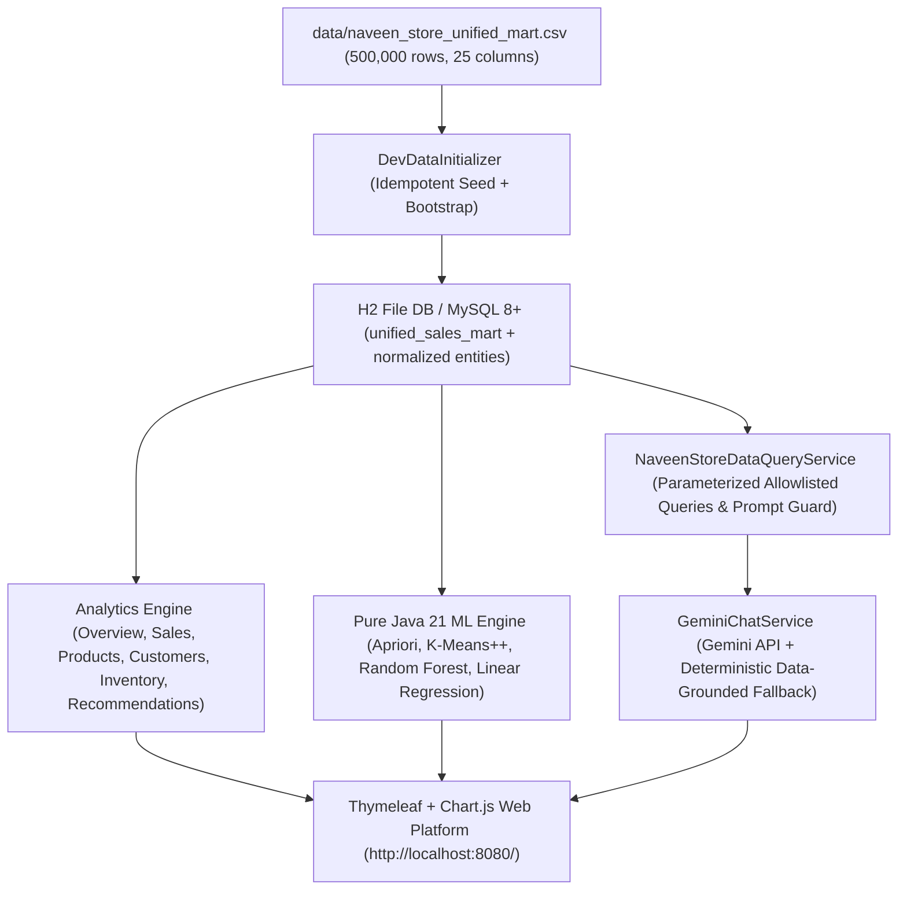

# Sankhya — Supermarket Analytics, ML & AI Platform

**Sankhya** is a full-stack **Supermarket Business Intelligence, Machine Learning, and Conversational Data Analyst** platform built with **Java 21** and **Spring Boot 3.3.5**. It is pre-configured as a turnkey single-store analytics suite for **Naveen Store (`STORE-001`)**, a supermarket in **Lucknow, Uttar Pradesh, India**, owned by **Sujal Kansal**.

Instead of setting up separate data warehouses, Python notebooks, or paid BI tools, Sankhya boots with an integrated **500,000-row analytical data mart** and immediately delivers live financial KPIs, pure-Java machine learning insights, CSV reporting exports, and an interactive conversational AI analyst (**Ask Naveen Store AI**) — with every figure formatted in **Indian Rupees (`INR`, `₹`)** using Indian lakh/crore grouping (for example, `₹18,25,42,617.45`).

---

## Table of Contents

- [At a Glance](#at-a-glance)
- [How It Works (Architecture & Data Flow)](#how-it-works-architecture--data-flow)
- [Quick Start Guide (Run Locally in Minutes)](#quick-start-guide-run-locally-in-minutes)
- [Platform Tour (What Each Page Does)](#platform-tour-what-each-page-does)
- [Inside the Dataset (`naveen_store_unified_mart.csv`)](#inside-the-dataset-naveen_store_unified_martcsv)
- [Technology Stack & Project Structure](#technology-stack--project-structure)
- [Running Tests & Verification](#running-tests--verification)
- [Further Documentation](#further-documentation)

---

## At a Glance

| Aspect | Details |
| :--- | :--- |
| **Store Identity** | **Naveen Store (`STORE-001`)** — Owner: **Sujal Kansal** — Lucknow, Uttar Pradesh, India |
| **Currency & Formatting** | Indian Rupees (`INR`, `₹`) with Indian numbering (`1,00,000`, `1,00,00,000`) everywhere in UI, CSVs & AI replies |
| **Dataset Volume** | `500,000` line items • `83,439` distinct receipts • `9,978` customers • `1,000` SKUs • `19` categories |
| **Transaction Date Window** | `2025-11-22 08:00:00` to `2026-11-22 23:00:00` (Full 1-year retail history) |
| **Built-In ML Engine** | Pure Java 21 implementations of **Apriori**, **K-Means++**, **Random Forest**, and **Linear Regression** |
| **Conversational AI** | **Ask Naveen Store AI** powered by allowlisted store queries + Google Gemini (`gemini-3.5-flash-lite`) with deterministic fallback |

---

## How It Works (Architecture & Data Flow)

When the application starts, `DevDataInitializer` checks whether **Naveen Store (`STORE-001`)** and its `500,000` rows are already loaded in the database. On first launch, it batches and validates [`data/naveen_store_unified_mart.csv`](data/naveen_store_unified_mart.csv) into the database, refreshes normalized product/customer/inventory views, runs the 4 pure-Java ML pipelines, and exposes everything through Spring MVC dashboards and APIs:



---

## Quick Start Guide (Run Locally in Minutes)

### 1. Prerequisites

- **Java 21 (JDK 21)** — Eclipse Temurin 21 or equivalent (`java -version` should report `21.x`)
- **Maven 3.9+** (`mvn -version`)
- **Unified Dataset File**: Place `naveen_store_unified_mart.csv` inside the `data/` directory at the project root (`data/naveen_store_unified_mart.csv`). *(Note: `data/` is gitignored so large dataset and database files are not committed to Git.)*

### 2. Optional: Enable Live Gemini AI Responses (`.env`)

Create a `.env` file in the project root directory to enable live Google Gemini narrative synthesis in **Ask Naveen Store AI**:

```properties
GEMINI_API_KEY=your_google_gemini_api_key
GEMINI_MODEL=gemini-3.5-flash-lite
```

> **No API key yet?** You can still run and explore the entire platform. Without `GEMINI_API_KEY` (or if the external Gemini service is temporarily unreachable), **Ask Naveen Store AI** automatically falls back to deterministic, data-grounded store answers built directly from database query results.

### 3. Build & Start the Server

Using the default development profile (`dev`), Sankhya automatically stores data in a local H2 file database (`./data/sankhya_dev_db.mv.db` in MySQL compatibility mode) so **you do not need to install or configure a separate MySQL server** to try the project locally.

**Windows (PowerShell):**

```powershell
mvn clean package
java -Xmx2g -jar target\sankhya-platform-1.0.0-SNAPSHOT.jar --spring.profiles.active=dev
```

**macOS / Linux:**

```bash
mvn clean package
java -Xmx2g -jar target/sankhya-platform-1.0.0-SNAPSHOT.jar --spring.profiles.active=dev
```

#### What happens during startup?
- **First startup:** `DevDataInitializer` imports all `500,000` rows from `data/naveen_store_unified_mart.csv`, validates store identity (`Naveen Store` / `STORE-001`), and bootstraps the 4 ML models and initial recommendations. Give it ~30–60 seconds to finish seeding and print the `Store & Owner` / `Mart Identity` startup banner.
- **Subsequent startups:** Sankhya detects the existing `500,000` verified rows, skips CSV re-seeding automatically, and starts in seconds.

### 4. Open & Sign In

Once Tomcat reports `Started SankhyaApplication`, open your browser to:

- **URL:** [http://localhost:8080/](http://localhost:8080/)

Sign in with either pre-seeded store owner account (after login you are taken directly to `/dashboard`):

| Email | Password | Role |
| :--- | :--- | :--- |
| `admin@sankhya.com` | `Password@123` | `ROLE_ADMIN` (Store Owner) |
| `sujal@naveenstore.com` | `Password@123` | `ROLE_ADMIN` (Store Owner) |

---

## Platform Tour (What Each Page Does)

Every screen reflects live database queries over **Naveen Store (`STORE-001`)** with interactive date range presets (`LAST_7_DAYS`, `LAST_30_DAYS`, `THIS_MONTH`, `THIS_YEAR`, `CUSTOM`):

### 1. Executive Overview (`/dashboard`)
Your high-level store command center:
- **Core KPIs with period-over-period comparisons:** Net Revenue (`₹`), Distinct Customer Receipts, Average Transaction Value (`₹`), Active Customers, Gross Margin %, and Low-Stock Reorder Alert count.
- **Charts & Summaries:** Daily revenue trend line, category revenue distribution, automated descriptive takeaways, and urgent recommendations.

### 2. Sales Intelligence (`/analytics/sales`)
Deep dive into store billing, basket size, and footfall patterns:
- **Financial & Basket Metrics:** Net Revenue, Promotional Discounts (`₹`), Average Ticket Value, Units Sold, and Items per Basket (`sales lines / distinct receipts`).
- **Operational Charts:** Hourly shopping traffic curve, payment method distribution, and a **14-day Linear Regression** revenue forecast.
- **Receipt Inspector:** Click any receipt (`BILL-...`) in the ledger modal to view its full line-item breakdown, quantities, prices, and discounts.

### 3. Product Intelligence (`/analytics/products`)
Understand what sells best and what makes the highest margin:
- **19-Category Profitability Table:** Compare revenue, COGS, gross profit, and gross margin % across all 19 supermarket categories.
- **BCG Growth-Share Classification:** Categorizes SKUs into *Star*, *Cash Cow*, *Opportunity*, and *Underperformer* quadrants.
- **Searchable 1,000-SKU Matrix & Apriori Bundles:** Filter all `1,000` products and inspect **Apriori Market Basket Analysis** rules (`Support`, `Confidence`, `Lift`) showing which items shoppers frequently buy together.

### 4. Customer Intelligence (`/analytics/customers`)
Analyze repeat shopping behavior across Naveen Store's `9,978` Lucknow buyers:
- **RFM Scoring & Lifecycle Segments:** Customers are scored on *Recency*, *Frequency*, and *Monetary* spend across 9 lifecycle segments, alongside Repeat Purchase Rate and Average Revenue Per User (`₹`).
- **Top Buyers & K-Means++ Clusters:** Leaderboard of highest-spend customers and **K-Means++** behavioral cluster assignments.

### 5. Inventory Intelligence (`/analytics/inventory`)
Track warehouse stock valuation and replenishment risk across all `1,000` deduplicated SKUs:
- **Warehouse Valuations & Health Breakdown:** Inventory cost value and retail value in `₹`, grouped into `HEALTHY` (`994`), `LOW_STOCK` (`3`), `OVERSTOCK` (`3`), and `OUT_OF_STOCK` (`0`), plus `169` SKUs currently at or below their safety reorder threshold.
- **Snapshot Transparency & ML Risk:** Explicitly displays the single inventory snapshot banner (`2026-11-22`), searchable 1,000-SKU stock position table, and **Random Forest** demand risk alerts.

### 6. Ask Naveen Store AI (`/analytics/ai-insights`)
A full-page conversational data analyst built directly into the sidebar — no complex BI filters required:
- **Safe Grounded Execution:** Natural-language questions are routed by `NaveenStoreDataQueryService` to parameterized, allowlisted store queries (never trusting raw LLM-generated SQL, and actively guarding against prompt-injection attempts).
- **Rich Answers:** Responses combine executive summaries with inline KPI tiles, sortable structured tables, and rendered Chart.js visualizations.
- **Honest Refusals:** If asked for data that does not exist in the mart (such as historical daily warehouse stock movement logs or supplier lead times), it explains the data gap directly instead of guessing.

**Example Questions to Try:**
- *"What changed in sales recently?"*
- *"Which products generate the highest revenue and profit?"*
- *"Which categories have the lowest gross margin?"*
- *"Who are the top customers by spend and frequency?"*
- *"Which inventory items are below reorder level?"*
- *"What products are frequently bought together?"*

### 7. Recommendations, Reports & Store Settings
- **Business Recommendations (`/analytics/recommendations`):** Rule-based operational alerts ranked by severity (`CRITICAL`, `HIGH`, `MEDIUM`) with status tracking.
- **CSV Export Hub (`/analytics/reports`):** Download UTF-8 CSV exports for Sales, Products, Customers, and Inventory with explicit `(INR)` monetary column headers.
- **Store Settings (`/settings`):** View store profile details (`STORE-001`, `Naveen Store`, `Sujal Kansal`, `Lucknow, Uttar Pradesh, India`) and connected user account info.

---

## Inside the Dataset (`naveen_store_unified_mart.csv`)

### Verified Full-Year Totals (`2025-11-22` to `2026-11-22`)

| Metric | Verified Value |
| :--- | :--- |
| **Total Sales Line Items (`unified_sales_mart`)** | `500,000` |
| **Distinct Receipts (`transaction_id`)** | `83,439` |
| **Distinct Customers (`customer_id`)** | `9,978` (Lucknow) |
| **Distinct Products (`product_id`)** | `1,000` across `19` categories |
| **Gross Revenue (before discounts)** | `₹18,46,85,091.30` |
| **Promotional Discounts** | `₹21,42,473.85` |
| **Net Revenue** | `₹18,25,42,617.45` |
| **Cost of Goods Sold (COGS)** | `₹13,85,29,200.70` |
| **Gross Profit** | `₹4,40,13,416.75` (`24.11%` gross margin) |
| **Inventory Snapshot (`2026-11-22`)** | `994` `HEALTHY` • `3` `LOW_STOCK` • `3` `OVERSTOCK` • `0` `OUT_OF_STOCK` (`169` ≤ reorder level) |

### Schema: All 25 Columns Explained

| Domain | Columns |
| :--- | :--- |
| **Store Identity (3)** | `store_id` (`STORE-001`), `store_name` (`Naveen Store`), `store_owner` (`Sujal Kansal`) |
| **Transaction & Receipt (6)** | `transaction_id` (`BILL-...`), `transaction_date`, `payment_method`, `cashier_name`, `quantity`, `discount` |
| **Customer Profile (4)** | `customer_id` (`CUST-...`), `customer_name`, `city` (`Lucknow`), `customer_segment` |
| **Product & Pricing (8)** | `product_id` (`SKU-...`), `product_name`, `category`, `subcategory`, `brand`, `unit_cost`, `selling_price`, `unit_price` |
| **Inventory Snapshot (4)** | `latest_inventory_snapshot_date`, `current_closing_stock`, `current_reorder_level`, `current_inventory_status` |

### Dataset Provenance & Explicit Limitations

- **Source & Synthetic Enrichment:** Product names, categories/subcategories, and co-occurrence basket structure derive from the public Instacart Market Basket dataset filtered to its top 1,000 products (some multi-item receipts reflect filtered partial baskets). Unit costs, selling prices, quantities, discounts, payment methods, cashiers, fictional Indian customer names, Lucknow assignment, and closing stock quantities are synthetic demonstration data, and transaction timestamps are reconstructed over `2025-11-22` through `2026-11-22`.
- **Single-Snapshot Inventory Disclosure:** The mart includes one product-level closing stock snapshot per SKU dated `2026-11-22`. It does **not** include daily stock-movement logs, opening/received stock drifts, shrinkage history, or supplier lead times — both `/analytics/inventory` and **Ask Naveen Store AI** explicitly disclose this limitation instead of fabricating historical inventory trends.

---

## Technology Stack & Project Structure

### Tech Stack

| Layer | Technologies |
| :--- | :--- |
| **Backend** | Java 21, Spring Boot 3.3.5, Spring MVC, Spring Security 6 (form login, CSRF, BCrypt) |
| **Data & Persistence** | Spring Data JPA / Hibernate, H2 (`dev` file DB in MySQL mode), MySQL 8+ (`prod`), Flyway (`V2`–`V6`), Spring `JdbcTemplate` |
| **Data Parsing & Export** | Apache Commons CSV, Apache POI |
| **Machine Learning** | Pure Java 21 implementations (Apriori, K-Means++, Random Forest, Linear Regression) |
| **AI Integration** | Google Gemini API via Spring `RestClient` + `NaveenStoreDataQueryService` |
| **Frontend** | Thymeleaf Server-Side Templates, Chart.js, Vanilla JavaScript, Custom CSS |

### Repository Layout

```text
Sankhya/
├── data/                                    # Place naveen_store_unified_mart.csv here; H2 dev DB stored here (gitignored)
├── docs/                                    # In-depth architecture, formula, ML, schema, and Gemini guides
├── src/
│   ├── main/
│   │   ├── java/com/sankhya/
│   │   │   ├── ai/                          # Safe allowlisted NaveenStoreDataQueryService, GeminiClient & GeminiChatService
│   │   │   ├── analytics/                   # Overview, Sales, Products, Customers, Inventory, Recommendations, Reports & AI
│   │   │   ├── auth/ & security/            # Login/registration controllers, AuthService, CustomUserDetails, SecurityConfig
│   │   │   ├── common/                      # AnalyticsMathUtils (INR formatting), GlobalModelAttributes, exceptions
│   │   │   ├── config/                      # DevDataInitializer (500,000-row idempotent seeder & ML bootstrap)
│   │   │   ├── dataset/                     # UnifiedSalesMart entity, repository, CSV/Excel parsers & query service
│   │   │   ├── ml/                          # Apriori, K-Means++, Random Forest, Linear Regression & MLJobService
│   │   │   ├── dashboard/                   # Executive overview controller (`/`, `/dashboard`, `/api/overview`)
│   │   │   └── customers/, products/, sales/, inventory/, workspace/, user/, onboarding/, generator/
│   │   └── resources/
│   │       ├── db/migration/                # Flyway SQL schemas (V2__phase2_datasets.sql .. V6__unified_sales_mart.sql)
│   │       ├── static/                      # Stylesheets and client-side JS chart/dashboard controllers
│   │       ├── templates/                   # Thymeleaf views (`analytics/`, `auth/`, `dashboard/`, `fragments/`, `layout/`, `settings/`)
│   │       ├── application.yml              # Base Spring Boot configuration
│   │       └── application-dev.yml          # Zero-setup H2 `dev` profile & `.env` Gemini configuration
│   └── test/java/com/sankhya/               # 33 JUnit / Spring MockMvc / ML / analytics test suites
└── pom.xml                                  # Maven build configuration (Java 21, Spring Boot 3.3.5)
```

---

## Running Tests & Verification

Run the complete automated test suite (covering authentication, security, data ingestion, analytics calculations, Indian Rupee formatting, and all 4 ML algorithms):

```bash
mvn test
```

Or run the full clean build and packaged JAR verification:

```bash
mvn clean package
```

---

## Further Documentation

Detailed design and engineering specifications are available inside [`docs/`](docs/):

- [Dataset Schema Documentation](docs/DATASET_SCHEMA_DOCUMENTATION.md)
- [Analytics Formula Documentation](docs/ANALYTICS_FORMULA_DOCUMENTATION.md)
- [Feature Engineering Documentation](docs/FEATURE_ENGINEERING_DOCUMENTATION.md)
- [ML Model Documentation](docs/ML_MODEL_DOCUMENTATION.md)
- [Gemini Integration Documentation](docs/GEMINI_INTEGRATION_DOCUMENTATION.md)
