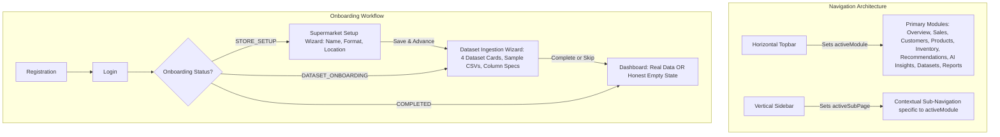

# SANKHYA — MASTER UI, NAVIGATION & WORKFLOW AUDIT
**Document:** `SANKHYA_UI_AND_WORKFLOW_AUDIT.md`
**Role:** Senior Full-Stack Architect & Quality Engineer
**Date:** November 22, 2026

---

## 1. Existing Application Implementation Overview

Sankhya is an AI-powered Supermarket Analytics & Business Intelligence platform constructed as a pure Java 21 / Spring Boot 3.3.5 modular monolith with Thymeleaf 3 and Tailwind CSS.

### Current Package Architecture:
- `com.sankhya.auth`: User authentication, registration, BCrypt password validation.
- `com.sankhya.workspace`: Multi-tenant workspace data model, isolation validations, role memberships (`OWNER`, `ADMIN`, `ANALYST`, `VIEWER`).
- `com.sankhya.dataset`: Ingestion pipeline for CSV and Excel files, column mapping, data preview, validation, and persistence.
- `com.sankhya.generator`: Synthetic supermarket data generation engine.
- `com.sankhya.analytics.*`: BI calculation modules for Executive Overview, Sales, Customers (RFM), Products (Pareto), Inventory (DIR/Stockout), and Rule-based Recommendations.
- `com.sankhya.ml.*`: Pure Java machine learning engine (K-Means, Apriori, Random Forest, OLS Regression).
- `com.sankhya.ai`: Google Gemini API client and prompt orchestration for business narratives and chat copilot.
- `src/main/resources/templates`: Thymeleaf views with `layout/base.html` master template, `topbar.html`, `sidebar.html`, and feature-specific views.

---

## 2. Confirmed Bugs and Architectural Deficiencies

| ID | Category | Component | Description & Root Cause |
| :--- | :--- | :--- | :--- |
| **BUG-01** | Routing | Analytics & Dashboard Templates | Links referencing `/datasets/generate` return HTTP 404 because the actual controller mapping in `DatasetManagementController` is `/datasets/sample-generator`. |
| **BUG-02** | Data Persistence | `Workspace` & `create.html` | Supermarket store format buttons in `create.html` only toggled CSS classes and appended text to `description`. The `Workspace` entity and DTO lacked structured fields for `storeFormat`, `city`, `state`, and `country`. |
| **BUG-03** | User Experience | `AuthService` & Registration | Registration created a default workspace using `[User Name] Supermarket` without asking for store details, and redirected to `/login` without guiding the new user through setup or dataset ingestion. |
| **BUG-04** | Navigation | `topbar.html` & `sidebar.html` | Both horizontal topbar and vertical sidebar repeated the exact same 9 primary modules and shared the single `currentPage` attribute, causing visual duplication and active state collisions. |
| **BUG-05** | False Information | `sidebar.html` | Static department percentages (Produce 98.2%, Dairy 94.1%, etc.) and static ML telemetry ("Inference latency <14ms") were hardcoded into the layout regardless of actual data. |
| **BUG-06** | False Information | `topbar.html` | Static POS synchronization indicators ("POS SYNC: LIVE • 142 txns/hr") and a fake unread notification count badge were displayed even with an empty database. |
| **BUG-07** | Accessibility | Dropdowns in `topbar.html` | Workspace switcher and user profile menus used CSS hover-only (`group-hover:block`), preventing reliable access on touch devices and keyboards. |

---

## 3. Broken Route Destinations

1. `/datasets/generate`: Referenced in `overview.html:73`, `sales.html:58`, `customers.html:58`, `products.html:58`, `inventory.html:58`. Target route is `/datasets/sample-generator`.
2. Topbar notification button: Uses `<button>` without action or target, pointing to static modal.
3. Topbar help link: Pointed to `#` or alert popup instead of documentation or guided onboarding.

---

## 4. Missing Functionality

1. **First-Time User Onboarding Flow**:
   - Supermarket Setup Wizard (`/onboarding/store-setup`) capturing supermarket name, store format, city, state, country, description.
   - Dataset Onboarding Wizard (`/onboarding/datasets`) with individual cards for Sales Transactions, Product Catalog, Customer Registry, and Inventory Stock.
   - Persisted onboarding status (`onboardingStatus`: `STORE_SETUP`, `DATASET_ONBOARDING`, `COMPLETED`).
2. **Sample Dataset Templates**:
   - Dedicated downloadable sample CSV templates for each dataset type (`/datasets/templates/{type}`).
3. **Dataset Schema Column Guidance**:
   - Visual guidance on required and optional columns for each dataset type during onboarding and upload.
4. **Honest Empty States**:
   - Comprehensive zero-data empty states across all analytics dashboards showing required datasets and direct upload CTAs.

---

## 5. Duplicate Functionality

- Horizontal navigation bar and vertical sidebar navigation displayed identical links (Overview, Sales, Customers, Recommendations, Inventory, Products, Business Insights, Datasets, Reports).
- Both used the same server-side model attribute `currentPage`.

---

## 6. Hardcoded Content to Remove

- `sidebar.html`: Department Pivot breakdown with hardcoded percentages.
- `sidebar.html`: Static Model Pipeline Status card ("Inference latency <14ms").
- `topbar.html`: POS Sync Live indicator ("142 txns/hr").
- `topbar.html`: Notification red badge and hardcoded notification items.

---

## 7. Proposed Corrections & Architecture Plan

---

## 8. Files to Be Modified

### Backend:
- `Workspace.java`: Add `storeFormat`, `city`, `state`, `country`, `onboardingStatus`.
- `WorkspaceCreateRequest.java`: Add fields for format, city, state, country.
- `WorkspaceResponse.java`: Expose new fields and onboarding status.
- `WorkspaceService.java` & `WorkspaceController.java`: Handle persistence and switching.
- `AuthService.java` & `AuthController.java`: Create user and initiate onboarding.
- `AuthenticationSuccessHandler.java`: Route first-time users to onboarding.
- `OnboardingController.java` (New): Orchestrate store setup and dataset onboarding wizard.
- `DatasetManagementController.java`: Add template download endpoints and alias `/datasets/generate`.
- Analytics Controllers: Update to supply `activeModule` and `activeSubPage`.
- `V5__workspace_store_format_and_onboarding.sql`: Flyway schema migration.

### Frontend:
- `layout/base.html`: Modern responsive layout with independent navigation attributes.
- `fragments/topbar.html`: Primary horizontal navigation, accessible click dropdowns, clean telemetry.
- `fragments/sidebar.html`: Contextual secondary sub-navigation driven by `activeModule` and `activeSubPage`.
- `templates/onboarding/store-setup.html` (New): Supermarket setup wizard.
- `templates/onboarding/datasets.html` (New): Dataset onboarding wizard with 4 cards and progress.
- `dashboard/overview.html`, `sales.html`, `customers.html`, `products.html`, `inventory.html`: Correct links and add honest empty states.

---

## 9. Untouched Core Modules (Strict Preservation)
The following verified modules must remain completely intact:
- Pure Java ML suite (`KMeansService`, `AprioriService`, `RandomForestClassifier`, `MultipleLinearRegression`).
- Feature engineering and scaling (`FeatureEngineeringService`, `FeatureScaler`).
- Official Google Gemini client and prompting engine (`GeminiClient`, `GeminiPromptService`).
- High-performance streaming parsers (`CsvFileParser`, `ExcelFileParser`).
- Analytics mathematical formulas (`AnalyticsMathUtils`).
- Spring Security core authentication provider and password encoder.
