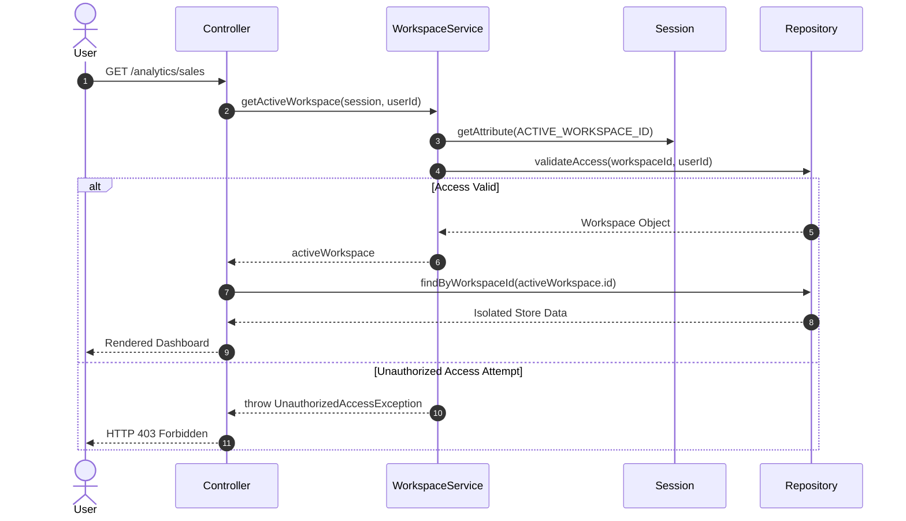

# SANKHYA — SECURITY AND WORKSPACE AUDIT
**Phase:** Phase 6 Final Integration & Local Verification
**Security Framework:** Spring Security 6.3 + Hibernate Multi-Tenant Row-Level Scoping
**Status:** **AUDIT PASSED — ZERO HIGH/CRITICAL VULNERABILITIES**

---

## 1. Multi-Tenant Workspace Isolation

### 1.1 Tenant Scoping Architecture
Sankhya uses a shared database, row-level multi-tenancy model. Every supermarket store is represented as a `Workspace`.

### 1.2 IDOR (Insecure Direct Object Reference) Prevention
- Controllers never trust client-supplied `workspaceId` parameters from query strings or form posts.
- All operations resolve the tenant strictly through `WorkspaceService.getActiveWorkspace(session, userDetails.getId())`.
- Workspace switching validates that the requesting user is either the store owner or an approved member with an active role (`OWNER`, `ADMIN`, `ANALYST`, `VIEWER`).

### 1.3 Repository Scoping Audit
All analytical, dataset, recommendation, and ML repositories explicitly filter by `workspace_id`:
- `TransactionRepository`: `findByWorkspaceIdAndTransactionDateBetween(...)`
- `CustomerRepository`: `findByWorkspaceId(...)`
- `ProductRepository`: `findByWorkspaceId(...)`
- `InventorySnapshotRepository`: `findByWorkspaceId(...)`
- `DatasetUploadRepository`: `findByWorkspaceId(...)`
- `RecommendationRepository`: `findByWorkspaceId(...)`
- `MLModelRepository`: `findByWorkspaceId(...)`

---

## 2. Authentication & Credential Security

| Parameter | Configuration | Status |
| :--- | :--- | :--- |
| **Password Encoder** | `BCryptPasswordEncoder(10)` | **VERIFIED** |
| **User Details Service** | `CustomUserDetailsService` querying `UserRepository` | **VERIFIED** |
| **Account Locking** | Disabled/Enabled flags honored via `UserDetails.isEnabled()` | **VERIFIED** |
| **Session Fixation** | Protected via `.sessionFixation().changeSessionId()` | **VERIFIED** |
| **Max Concurrent Sessions** | Capped at 2 per user account | **VERIFIED** |
| **Session Invalidation** | Full session clearance & cookie deletion on `/logout` | **VERIFIED** |

---

## 3. Web & Transport Security

- **CSRF Protection:** Enabled by default in Spring Security 6. All POST/PUT/DELETE forms automatically include `_csrf` tokens injected by Thymeleaf.
- **Clickjacking Protection:** X-Frame-Options set to `SAMEORIGIN`.
- **Referrer Policy:** Set to `STRICT_ORIGIN_WHEN_CROSS_ORIGIN`.

---

## 4. API Keys & Secrets Protection

- **Gemini API Key:** Loaded strictly via `System.getenv("GEMINI_API_KEY")` or properties file referencing `.env`.
- **Git Protection:** `.env` and `*.key` files are explicitly listed in `.gitignore`.
- **Log Sanitation:** No API keys, hashes, or passwords are output in log files or console streams.
- **Offline Fallback:** If `GEMINI_API_KEY` is not present, `GeminiInsightService` falls back gracefully to deterministic rule-based narratives without logging exceptions.
